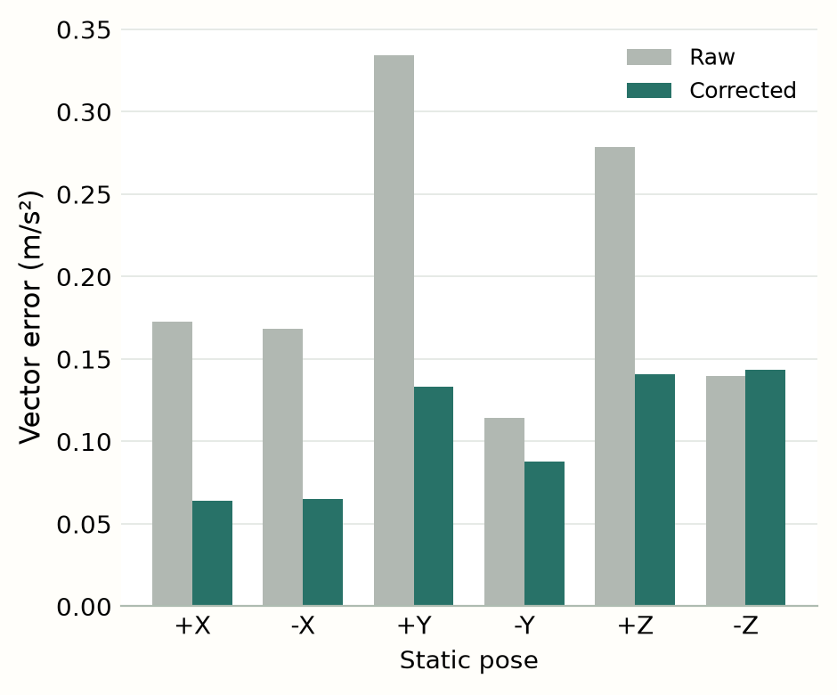
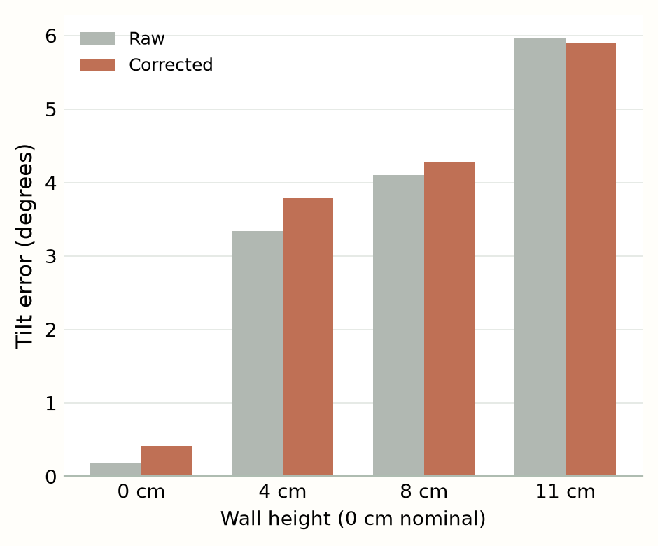
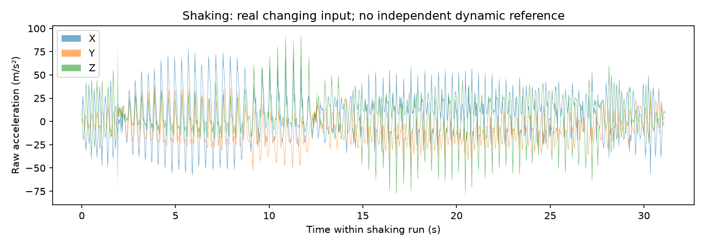

01 / Experiment & question

# Is your phone linear?

Melis Derveni · Harsimranjeet Kaur Measured report draft · 23 October 2026

One phone, one affine correction. Does it improve measurements beyond the six positions used to fit it?

### In what sense linear?

We model the measured acceleration vector \(\mathbf m\) from a reference \(\mathbf a\):

\[\boxed{\mathbf m=\mathbf S\mathbf a+\mathbf b}\qquad \mathbf S\in\mathbb R^{3\times3},\quad \mathbf b\in\mathbb R^3.\]

\(\mathbf S\) contains dimensionless gains and cross-axis coupling; \(\mathbf b\) is a constant bias in \(\mathrm{m\,s^{-2}}\). This is **affine**, linear when \(\mathbf b=\mathbf0\), and linear in twelve parameters. No separate noise term is fitted.

\[\begin{bmatrix}\mathbf m\\1\end{bmatrix}=\begin{bmatrix}\mathbf S&\mathbf b\\\mathbf0^\mathsf T&1\end{bmatrix}\begin{bmatrix}\mathbf a\\1\end{bmatrix}.\]

### Measurement design

Samsung Galaxy S25 Ultra (SM-S938B), Android 16, phyphox 1.2.1, **Acceleration with g**. The nominal stationary reference is \(g=9.81\,\mathrm{m\,s^{-2}}\); gravity remains in the signal.

| Collection | Acquisition | Role |
| --- | --- | --- |
| 21 October | Six signed positions, two repeats each | First repeats fit; second repeats test |
| Static samples | 86,323 training · 86,124 testing | Whole runs; no random row split |
| 22 October | Eight angle runs · two heights | All angle runs held out from fitting |
| 23 October | Four screen-up runs · four heights | New session; existing model unchanged |
| Limit recording | 31.15 s shaking · 14,745 samples | Gravity-interpretation demonstration |

We use nominal references \(\pm g\mathbf e_x,\pm g\mathbf e_y,\pm g\mathbf e_z\), acknowledging camera/button contacts despite steady support. Static repeats are within-session.

### Independent angle references

The new screen-up session uses the same 16 cm hypotenuse, at contact heights 0, 4, 8 and 11 cm:

\[\theta_{\mathrm{ref}}=\arcsin\!\left(\frac hL\right)\quad\Rightarrow\quad 0^\circ,\;14.48^\circ,\;30.00^\circ,\;43.43^\circ.\]

The 57,686 samples span four approximately 30 s runs. Table-rest 0° is nominal (camera bumps). References and earlier results remain unchanged.

<!-- page -->

02 / Calibration & identification

## One model, twelve parameters

Harsimranjeet's regression fits one mean measured vector per training position. Equal pose weights prevent slightly longer recordings dominating. The separate analysis preserves her notebook and adds validation and reproducible exports.

\[\mathbf X_i=\begin{bmatrix}a_{ix}&a_{iy}&a_{iz}&1\end{bmatrix},\quad \mathbf M_i=\bar{\mathbf m}_i^\mathsf T,\quad \mathbf B=\begin{bmatrix}\mathbf S^\mathsf T\\\mathbf b^\mathsf T\end{bmatrix}.\]

\[\widehat{\mathbf B}=\underset{\mathbf B}{\operatorname{argmin}}\,\lVert\mathbf X\mathbf B-\mathbf M\rVert_F^2,\qquad \widehat{\mathbf S}\,\widehat{\mathbf a}=\mathbf m-\widehat{\mathbf b}.\]

We use SVD least squares, without normal-equation inversion. Correction solves the second equation; tilt is then calculated from the corrected vector. **There is no second angle regression.**

### The fitted calibration

\[\widehat{\mathbf S}=\begin{bmatrix}0.999562&-0.008063&0.015706\\0.005597&0.997870&0.003440\\-0.003154&0.005892&0.998447\end{bmatrix},\qquad \widehat{\mathbf b}=\begin{bmatrix}-0.050740\\0.068563\\0.104316\end{bmatrix}\;\mathrm{m\,s^{-2}}\]

Rounded to six decimals. Full precision and training provenance are stored in the fitted JSON.

### Which positions, and why?

Unique identification requires \(\operatorname{rank}(\mathbf X)=4\). Four affinely independent references suffice; six opposite positions add redundancy. The planar \(\pm X,\pm Y\) subset has rank 3 and cannot identify the Z response. One repeated reference has rank 1. Gravity magnitudes alone cannot determine arbitrary matrix orientation.

| Numerical check | Value |
| --- | ---: |
| Design rank | 4 |
| Singular values of \(\mathbf X\) | 13.873435 (three times), 2.449490 |
| \(\kappa_2(\mathbf X)\) / dimensionless \(\kappa_2(\mathbf X_g)\) | 5.663806 / 1.732051 |
| \(\kappa_2(\widehat{\mathbf S})\) | 1.015951 |

### Stable samples, frozen choices

Exclude the first/last second, then screen 0.25 s windows by local RMS vector variation. The training-only rule, \(\max(0.05,\mathrm{median}+8\times1.4826\,\mathrm{MAD})\), freezes at \(0.05\,\mathrm{m\,s^{-2}}\). Keep stable intervals of at least 1 s; gaps over 0.1 s break continuity. Masks were visually checked. Retained samples: **80,677 training; 80,474 testing**. No target-error filtering is used.

The authors jointly chose full affine coupling over a simpler diagonal model, accepting more parameters and sensitivity to reference alignment. Means give equal weights but hide variation, so raw data and masks are retained. Whole-run holdouts avoid adjacent-row mixing but remain correlated within a session. No choice was retuned using held-out errors.

<!-- page -->

03 / Held-out evidence

## Calibration results

### How much improvement?

Metrics compare identical windows and equally weight six static pose means or four new angle run means. Direction and tilt errors are distinct.

| Held-out RMSE | Raw | Corrected |
| --- | ---: | ---: |
| Static vector · \(\mathrm{m\,s^{-2}}\) | 0.215965 | **0.111114** |
| Static magnitude · \(\mathrm{m\,s^{-2}}\) | 0.078677 | **0.048051** |
| Static direction · degrees | 1.173729 | **0.585285** |
| New angle tilt · degrees | **3.988562** | 4.110647 |

\[\mathrm{RMSE}_{\mathrm{vec}}=\sqrt{\frac1N\sum_{i=1}^{N}\lVert\mathbf v_i-\mathbf a_i\rVert_2^2}.\]

Static vector RMSE falls **48.6%**. Mean vector error falls from 0.201209 to 0.105644 \(\mathrm{m\,s^{-2}}\), reproducing the notebook closely. The \(-Z\) vector error worsens slightly: 0.139936 to 0.143284 \(\mathrm{m\,s^{-2}}\).

### Which linearity test?

The new angles test component predictions on a fixed-gravity sphere, not unrestricted homogeneity. The screen-up long-axis slope is

\[\theta(\mathbf v)=\operatorname{atan2}\!\left(|v_y|,\sqrt{v_x^2+v_z^2}\right).\]

The demonstrated benefit is the **static repeat test**. New tilt RMSE is 3.99° raw / 4.11° corrected; raised-only RMSE is 4.60° / 4.74°. Tilt improvement is not established, with or without nominal 0°. Earlier results (3.27° / 3.73°) remain recorded separately; references are unchanged.

Figure 1 · Static pose means. Improvement is not universal.

Figure 2 · New angle validation; nominal 0° rests on camera bumps.

<!-- page -->

04 / Limits & responsibility

## Use, limits and responsibility

The effective correction is supported for the tested nominal static positions. The measured angle references are accepted as supplied; this validation does not isolate sensor behaviour from alignment effects. No claim of unrestricted accuracy follows from a good static fit.

### Where does the model fail?

The shaking run is retained in full. Peak vector magnitude is **119.821** \(\mathrm{m\,s^{-2}}\); RMS magnitude deviation from \(g\) is **29.115** \(\mathrm{m\,s^{-2}}\). Without an independent dynamic reference, these are signal statistics—not acceleration errors, clipping evidence or proof of non-affine response.

Figure 3 · Real changing specific force invalidates gravity-only tilt interpretation. Pixel-bin envelopes retain extremes.

### What the demonstration establishes

The same exported calibration corrects fresh acceleration on shared timestamps and scales. Synthetic preview is labelled; reference comparisons require an independent target and still-phone confirmation. A 3D display hold is an intentional safeguard, not a measured sensor failure.

### What remains unresolved

Four distinct height settings now extend angle coverage, with one run each and nominal camera-supported 0°. Static repeats remain within-session. Ruler precision, case/rate consistency and physical rehearsal remain to document. A referenced drift or controlled-input experiment is needed for an affine-failure claim.

Both authors retain negative results. Any tuning from these validation errors requires fresh held-out data for a new performance claim.

### Both authors worked on the project

**Melis Derveni** performed measurements and experiments and prepared the report, README, live demonstration and other deliverables. **Harsimranjeet Kaur** developed model training, testing and evaluation. Both discussed alternatives, advantages and limitations and jointly agreed the experimental approach, model and analysis decisions.

Melis Derveni · signature / date

Harsimranjeet Kaur · signature / date

**Evidence & reproduction.** Original exports, 21–23 October 2026; user-confirmed geometry; Harsimranjeet's unchanged `main.ipynb`. Static: `python -m calib.analysis`. New angles: `python scripts/validate_new_angles.py`. Tests: `python -m pytest`. Raw data, frozen fit and prior results are preserved. Browser checks do not replace physical rehearsal.

**Sources.** Course brief, *Sprint project: Is your phone linear?*; [phyphox sensor definitions](https://phyphox.org/docs/file-format/input/) and [remote API](https://phyphox.org/docs/remote-interface/). Calibration does not remove gravity, random noise or lost clipped information.

