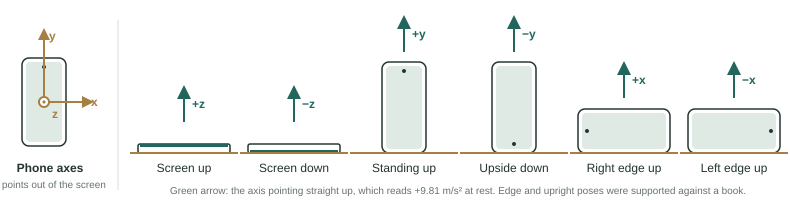
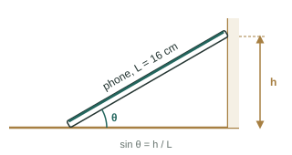
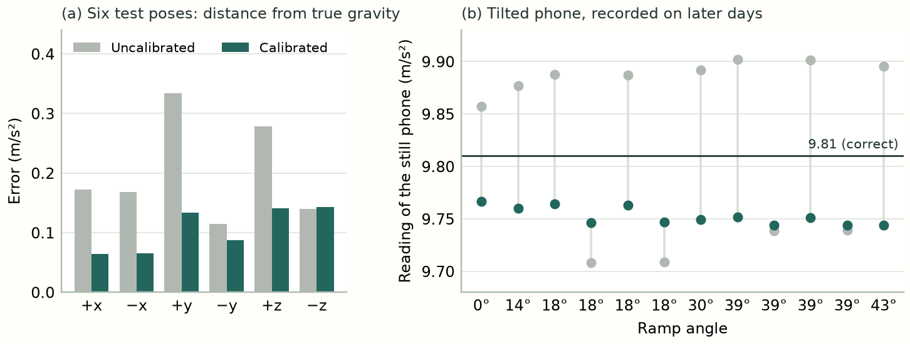
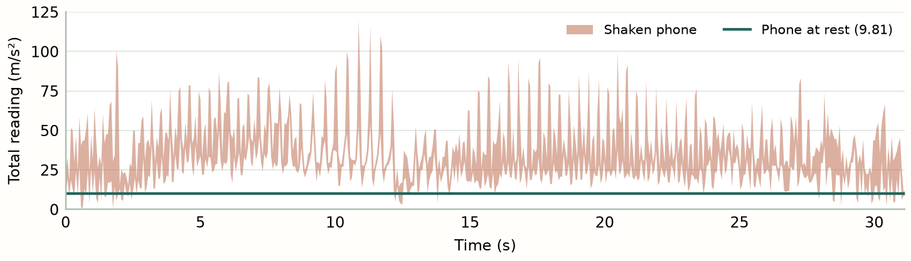

Sprint project · Samsung Galaxy S25 Ultra · phyphox “Acceleration with g”

# Is your phone linear?

Melis Derveni · Harsimranjeet Kaur · 23 October 2026

We calibrated our phone's accelerometer from six resting poses, tested the correction on recordings it had never seen, and looked for where the model stops working.

## 1 · Question and hypothesis

A phone lying still feels only gravity: an arrow 9.81 m/s² long, pointing up. Each of the phone's three axes (x across the screen, y along it, z out of it) reports how much of that arrow falls along it. A perfect sensor would report the true acceleration \(\mathbf a\). A real one has small gain errors, axes that are slightly crossed, and a constant offset. Our hypothesis is that the reading \(\mathbf m\) follows

\[\boxed{\mathbf m=\mathbf S\,\mathbf a+\mathbf b}\]

Here the 3×3 matrix \(\mathbf S\) describes how strongly each axis responds, ideally the identity, and the vector \(\mathbf b\) is a constant offset, ideally zero.

**Is this linear?** Not strictly. A linear sensor reads zero when nothing acts on it, and twice as much when the input doubles. The offset \(\mathbf b\) breaks the first rule, so the model is **affine**: a straight line that misses the origin, like \(y=2x+1\). Adding a constant 1 as a fourth coordinate turns it back into a single linear map:

\[\begin{bmatrix}\mathbf m\\1\end{bmatrix}=\begin{bmatrix}\mathbf S&\mathbf b\\\mathbf 0^\mathsf T&1\end{bmatrix}\begin{bmatrix}\mathbf a\\1\end{bmatrix}\]

**Our answer in short:** for a phone at rest, the sensor follows this straight-line model wherever we tested it. It fails when the phone moves, because the reading then contains more than gravity.

## 2 · Data

We recorded everything with one phone, using the phyphox experiment *Acceleration with g*, and kept the exported files unchanged.

**Six resting poses (21 October).** The phone lay still for about 30 s in each pose of Figure 1, so that each axis pointed straight up once and straight down once. We recorded every pose twice. The first recording of each pose trained the model; the second was kept aside for testing. We trimmed the first and last second of every recording, and any moment where the phone was disturbed.

Figure 1 · The six training poses. In each, one axis points straight up and should read +9.81 m/s².

<!-- page -->

**Tilted phone (22 and 23 October).** To test angles the model never saw, we leaned the phone against a wall (Figure 2). The phone is 16 cm long; we raised its top to heights between 0 and 11 cm, giving angles from 0° to 43°.

**Shaking (22 October).** For the failure experiment, we shook the phone hard for 30 s.

Figure 2 · Tilt tests: the angle follows from the measured height h.

The model we trained

## 3 · Model and estimation

**What the fit sees.** Each training recording is averaged into one reading. In each pose we take the true acceleration to be gravity along one axis: for example \((0,0,+9.81)\) for *screen up*. That gives six pairs of “true value, reading”.

**The equations we solved.** Writing the model for all six poses at once gives one system of equations. The left matrix holds the true values plus a column of ones (for the offset):

\[\underbrace{\begin{bmatrix}+g&0&0&1\\-g&0&0&1\\0&+g&0&1\\0&-g&0&1\\0&0&+g&1\\0&0&-g&1\end{bmatrix}}_{\mathbf X:\ \text{six poses}}\;\begin{bmatrix}\mathbf S^\mathsf T\\\mathbf b^\mathsf T\end{bmatrix}\;\approx\;\underbrace{\begin{bmatrix}\text{reading in pose }+x\\\vdots\\\text{reading in pose }-z\end{bmatrix}}_{\text{measured}}\]

The unknowns, the 12 numbers in \(\mathbf S\) and \(\mathbf b\), are only multiplied by known numbers. So this is a *linear* problem, whatever the sensor really does. Harsimranjeet solved it by least squares, which finds the \(\mathbf S\) and \(\mathbf b\) whose predictions come closest to all six readings at once.

**The model we trained.**

\[\mathbf S=\begin{bmatrix}1.000&-0.008&0.016\\0.006&0.998&0.003\\-0.003&0.006&0.998\end{bmatrix},\qquad \mathbf b=\begin{bmatrix}-0.051\\0.069\\0.104\end{bmatrix}\ \mathrm{m/s^2}\]

In words: the gains on the diagonal are within 0.2 % of 1, the axes are crossed by at most about 1.6 %, and the offsets are up to 0.1 m/s². Small as they are, these errors matter for a spirit level: an offset of 0.1 m/s² is enough to make a flat phone look tilted by about half a degree.

**Using the model.** To correct a new reading, the phone undoes the model:

\[\hat{\mathbf a}=\mathbf S^{-1}\,(\mathbf m-\mathbf b)\]

The live demo applies exactly this to every new sample, and computes the tilt from the corrected reading.

<!-- page -->

What the data show

## 4 · Evidence

### Calibrated versus uncalibrated

Figure 3a uses the six test recordings, which the fit never saw. Calibration roughly **halves the error**: the typical distance from true gravity drops from 0.22 to 0.11 m/s², and the tilt error from 1.2° to 0.6°. One pose, screen down, does not improve.

Figure 3b uses tilted recordings from other days. A phone at rest should read exactly 9.81 m/s² at any angle. Uncalibrated, the reading wanders with the angle. Calibrated, it sits in a narrow band just below 9.81, about 0.06 m/s² low, at every angle.

Figure 3 · Error before (grey) and after (green) calibration, on recordings not used for fitting.

One result did not improve. On the wall tests, the phone reads roughly 3–6° less than the angle we computed from the ruler, with or without calibration. Calibration shifts these readings by less than 1°, so it cannot close the gap. The gap comes from how the phone rests against the wall and table, not from the sensor; we kept the measured heights unchanged.

### Where it breaks

The model turns a reading into a tilt by assuming the phone feels only gravity. When the phone moves, its own acceleration adds to gravity. In our shaking test (Figure 4) the reading swings up to 120 m/s², about 12 times gravity, and almost never passes through the resting value of 9.81. Any tilt computed from it is meaningless, calibrated or not. We had no second instrument measuring the true shaking, so we cannot say whether the sensor itself stopped being linear. What fails is our model's assumption that the phone is at rest.

Figure 4 · Shaking: the total reading compared with a phone at rest.

The sensor also has built-in limits: it clips above 157 m/s² (16 g) on any axis, which our shaking never reached, and it counts in steps of 0.005 m/s², too small to matter for a spirit level.

<!-- page -->

The five questions

**1 · In which sense is the sensor linear?** It is affine: a straight line plus an offset (\(\mathbf b\) up to 0.1 m/s²). With an extra coordinate it becomes a linear map (Section 1). Estimating \(\mathbf S\) and \(\mathbf b\) is a linear problem even if the sensor were not linear, because the unknowns are only multiplied by known numbers (Section 3).

**2 · How do you know?** We tested homogeneity: if an axis gets a fraction of the input, does it give the same fraction of the output? We trained only with gravity fully along one axis. On the tilted recordings each axis feels only part of gravity, from about 20 % to 98 %. If the axes did not scale in proportion, the corrected reading of a still phone would drift away from 9.81 at these in-between angles. It does not: it stays within 0.07 m/s² (0.7 %) of 9.81 at every angle, as close as at the training poses (Figure 3b).

**3 · Which poses did we need, and why?** The 12 unknowns can only be found uniquely if the matrix \(\mathbf X\) in Section 3 has rank 4, that is, four independent rows. Our six poses give rank 4, with a spare pair as a check. A set without a vertical z pose is not enough: if the phone never lies screen up or down, the third column of \(\mathbf X\) is all zeros, the rank drops to 3, and the sensor's response along z cannot be found.

**4 · How much does calibration help?** On test recordings it halves the error, from 0.22 to 0.11 m/s², and from 1.2° to 0.6° of tilt (Figure 3a). On tilted recordings from other days, every still reading sits in a narrow band just below 9.81 (Figure 3b). The wall-ramp angles do not improve, for reasons outside the sensor (Section 4).

**5 · Where does linearity break?** When the phone moves: shaking drives the reading up to 120 m/s², and the gravity-only model fails completely (Figure 4). The sensor also clips above 157 m/s² and cannot resolve steps below 0.005 m/s². A user should read tilt only while the phone is still; the live demo warns when it is not.

## 5 · Limits and one more week

Our test recordings came from the same session as the training ones, not from a second day. In each pose we assumed gravity lies exactly along one axis, but the phone rests slightly tilted, for example on its camera bump. Some of the cross terms in \(\mathbf S\) may describe that tilt rather than the sensor, which could explain why the ramp angles did not improve. With one more week we would repeat the six poses on a second day in a precisely square holder, check the ramp angles with a digital inclinometer, and test accelerations above 1 g with a known reference such as a turntable.

**Contributions.** **Melis Derveni** performed the measurements and experiments and prepared the report, README, live demonstration and other deliverables. **Harsimranjeet Kaur** developed model training, testing and evaluation. Both discussed alternatives, advantages and limitations, and jointly agreed the experimental approach, model and analysis decisions.

Melis Derveni · signature / date

Harsimranjeet Kaur · signature / date

